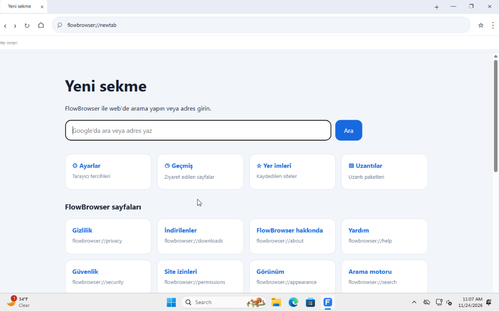
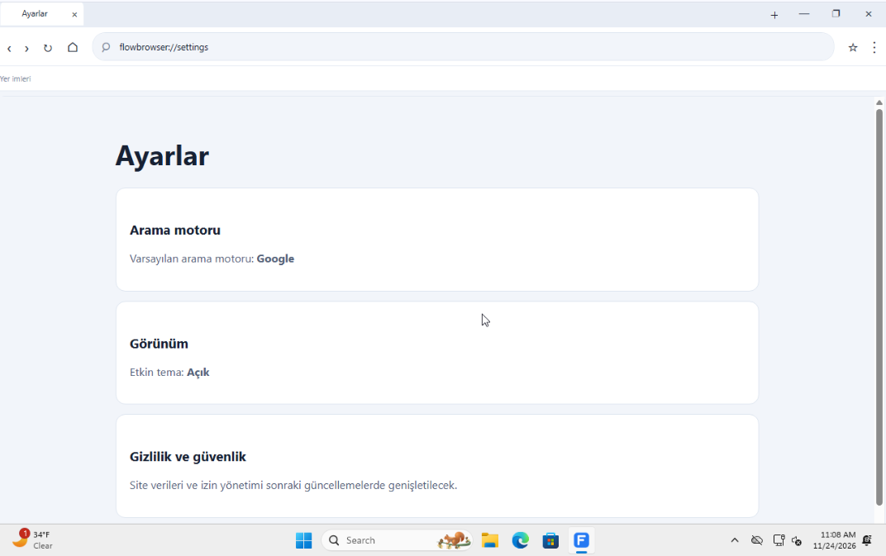
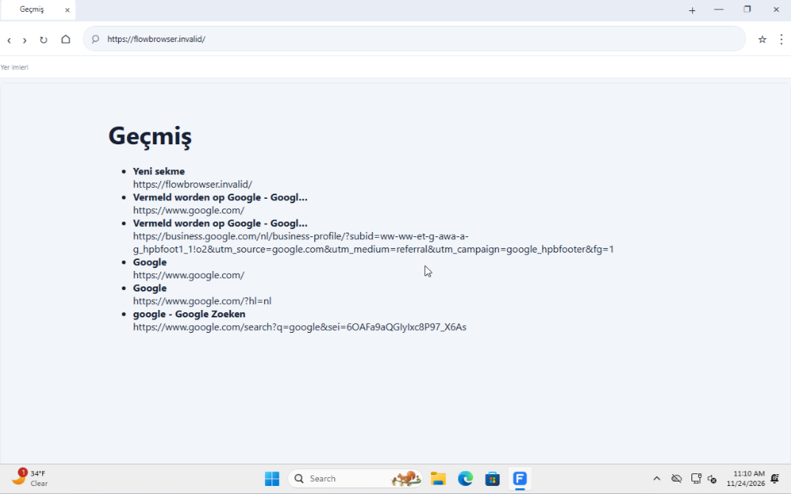
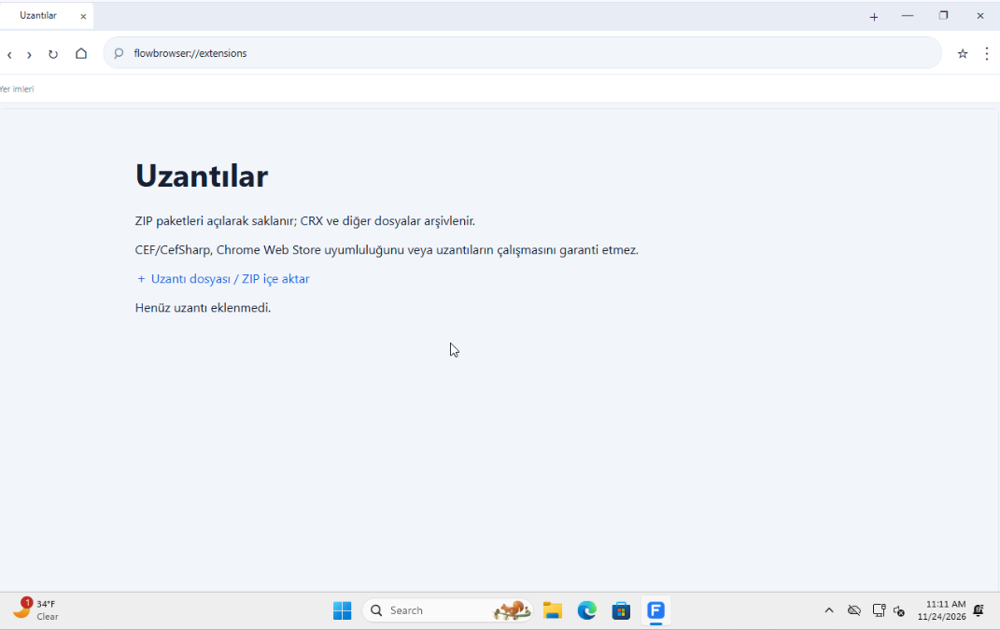
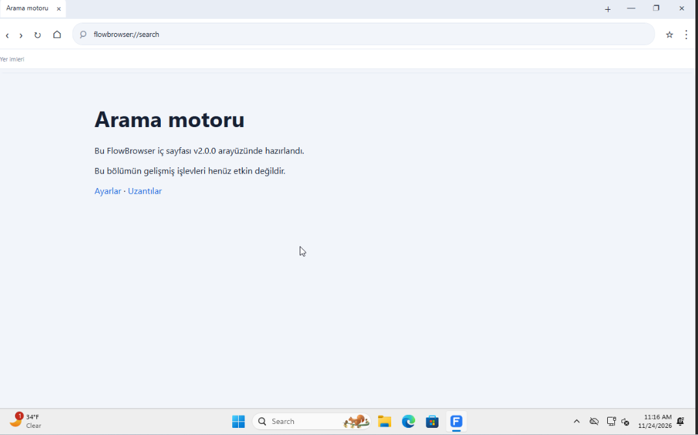
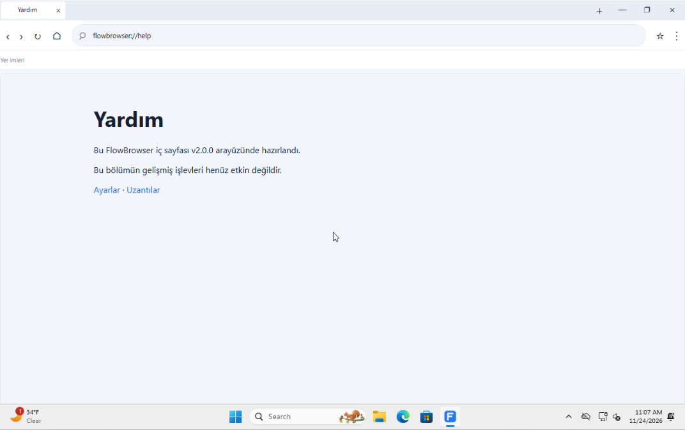

# FlowBrowser

**A Chromium-based desktop web browser for Windows.**

FlowBrowser is a desktop web browser built with C#, WPF, CefSharp, and Chromium Embedded Framework (CEF). It features a custom browser interface, tab management, bookmarks, browsing history, and configurable browser settings.

## Screenshots

## Features

- Chromium-based web browsing
- Custom desktop browser interface
- Tab management
- Custom new tab page
- Address bar and web search
- Back, forward, reload, and home navigation
- Bookmarks
- Browsing history
- Light and dark themes
- Configurable search engine
- Browser context menu
- 30 additional internal browser pages
- Keyboard shortcuts

## Internal Pages

FlowBrowser includes 30 additional internal pages accessible through the `flowbrowser://` address scheme.

| # | Internal Address | Page |
|---:|---|---|
| 1 | `flowbrowser://privacy` | Privacy |
| 2 | `flowbrowser://downloads` | Downloads |
| 3 | `flowbrowser://about` | About FlowBrowser |
| 4 | `flowbrowser://help` | Help |
| 5 | `flowbrowser://security` | Security |
| 6 | `flowbrowser://permissions` | Site Permissions |
| 7 | `flowbrowser://appearance` | Appearance |
| 8 | `flowbrowser://search` | Search Engine |
| 9 | `flowbrowser://startup` | Startup |
| 10 | `flowbrowser://tabs` | Tabs |
| 11 | `flowbrowser://languages` | Languages |
| 12 | `flowbrowser://accessibility` | Accessibility |
| 13 | `flowbrowser://system` | System |
| 14 | `flowbrowser://reset` | Reset Settings |
| 15 | `flowbrowser://shortcuts` | Keyboard Shortcuts |
| 16 | `flowbrowser://passwords` | Passwords |
| 17 | `flowbrowser://autofill` | Autofill |
| 18 | `flowbrowser://site-data` | Site Data |
| 19 | `flowbrowser://cookies` | Cookies |
| 20 | `flowbrowser://cache` | Cache |
| 21 | `flowbrowser://notifications` | Notifications |
| 22 | `flowbrowser://popups` | Pop-ups |
| 23 | `flowbrowser://camera` | Camera Permissions |
| 24 | `flowbrowser://microphone` | Microphone Permissions |
| 25 | `flowbrowser://location` | Location Permissions |
| 26 | `flowbrowser://protocols` | Protocol Handlers |
| 27 | `flowbrowser://experiments` | Experimental Features |
| 28 | `flowbrowser://diagnostics` | Diagnostics |
| 29 | `flowbrowser://license` | Licenses |
| 30 | `flowbrowser://update` | Updates |

### Core Browser Pages

The following pages are also available:

| Internal Address | Description |
|---|---|
| `flowbrowser://newtab` | New tab page |
| `flowbrowser://settings` | Browser settings |
| `flowbrowser://history` | Browsing history |
| `flowbrowser://bookmarks` | Saved bookmarks |
| `flowbrowser://extensions` | Extension management |

**Important:** The 30 additional internal pages are currently informational or placeholder pages. Their advanced functionality has not yet been enabled. The core pages have varying levels of implemented functionality.

## Keyboard Shortcuts

| Shortcut | Action |
|---|---|
| `Ctrl + L` | Focus the address bar |
| `Ctrl + T` | Open a new tab |
| `Ctrl + W` | Close the current tab |
| `Ctrl + R` | Reload the current page |
| `Alt + Left` | Go back |
| `Alt + Right` | Go forward |

## Extensions

FlowBrowser includes an extension import interface.

Currently, importing an extension file does not guarantee that the extension will be installed or activated in Chromium. Full extension support is not guaranteed.

## Downloads

Download the latest available FlowBrowser release:

**[View all releases](https://github.com/test36528928-blip/FlowBrowser/releases)**

Available release packages may include:

- **Windows x64 Installer:** `FlowBrowser-Setup-x64.exe`
- **Portable Version:** `FlowBrowser-Portable-x64.zip`

Release assets are provided when published.

## System Requirements

- Windows 10 or Windows 11 (64-bit)
- x64-compatible processor
- Sufficient disk space for the browser and its Chromium components

The distributed builds are configured as self-contained applications and include the required runtime components.

## Privacy

FlowBrowser stores browser data such as settings, bookmarks, and browsing history locally on the device.

When visiting websites or using web search, your browser communicates with the relevant websites and services.

FlowBrowser does not currently claim to provide complete tracking protection, anonymity, or advanced privacy protection.

## Technology Stack

- **Language:** C#
- **Desktop UI:** WPF
- **Browser Engine:** Chromium Embedded Framework (CEF)
- **Browser Integration:** CefSharp
- **Runtime:** .NET 10
- **Installer:** Inno Setup

## Development

FlowBrowser is actively being developed.

Some advanced browser features are still under development and may not be fully functional.

## Roadmap

Planned improvements may include:

- Improved browser settings
- More complete extension support
- Additional privacy controls
- Improved download management
- Further interface improvements
- Additional browser features

Roadmap items are plans, not guaranteed release features.

## Bug Reports and Feedback

Found a bug or have a suggestion?

[Open an issue](https://github.com/test36528928-blip/FlowBrowser/issues)

## License

No license has currently been specified in this repository. All rights remain with their respective owners.
